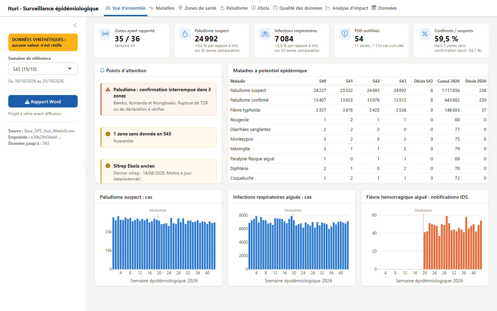

# Surveillance épidémiologique de l'Ituri : rapport automatisé et analyse reproductible

[English version](README.md)

À partir de la base IDS de la DPS, ce projet produit le rapport hebdomadaire, un tableau de bord interactif et une analyse reproductible.

> **État :** travail en cours. Les données réelles et le texte du manuscrit restent hors du dépôt tant que leurs propriétaires n'ont pas autorisé leur diffusion.

## Tableau de bord

Sous Windows, double-cliquer sur [`dashboard/Lancer_tableau_de_bord.bat`](dashboard/Lancer_tableau_de_bord.bat). Le navigateur s'ouvre ; garder la fenêtre noire ouverte et la fermer pour arrêter. L'application n'est accessible que depuis cet ordinateur.

| Page | Question à laquelle elle répond |
|---|---|
| Vue d'ensemble | Que faut-il regarder en priorité cette semaine ? |
| Maladies | Comment évolue une maladie, où, et avec quelle incidence ? |
| Zones de santé | Quelle est la situation d'une zone donnée ? |
| Paludisme | La tendance reflète-t-elle la maladie ou une rupture de confirmation ? |
| Ebola | Que dit le dernier sitrep, et concorde-t-il avec l'IDS ? |
| Qualité des données | Quelles zones manquent, et quels conflits arbitrer avec la DPS ? |
| Analyse d'impact | Quels résultats résistent aux contrôles de robustesse ? |
| Données | Filtrer et exporter en CSV ou Excel |

Sans base réelle, le tableau de bord démarre sur des données synthétiques, signalées par un bandeau. `Lancer_tableau_de_bord.bat --demo` force ce mode. La page « Analyse d'impact » nécessite les modèles calculés par `Rscript run_all.R --cible=article`. Voir le [guide du tableau de bord](dashboard/README.md).

**Aperçu, sur données synthétiques (aucune valeur n'est réelle) :**



Toutes les pages sont présentées dans le [README en anglais](README.md#screenshots).

## Essai rapide, sans données réelles

```
Rscript -e "install.packages('renv'); renv::restore()"
Rscript run_all.R --demo
```

Les sorties vont dans `outputs/demo/` et portent la mention « données synthétiques ».

## Chaque semaine

1. Déposer la nouvelle base dans `data/raw/`, sans la modifier : `Base_DPS_Ituri_Week44.xlsx`.
2. Si disponibles, compléter :
   - `data/external/mve_provinces.csv` et `mve_zones.csv` : nouveau sitrep (lignes ajoutées, anciennes conservées) ;
   - `data/external/completude_as.csv` : complétude par aire de santé ;
   - `notes/S44.md` : informations de terrain, texte libre.
3. Lancer :

```
Rscript run_all.R --cible=hebdo --semaine=44
```

4. Relire le rapport, puis le diffuser. Il indique lui-même ce qui manque, par exemple un sitrep trop ancien.

Le tableau de bord utilise automatiquement la base la plus récente à son prochain lancement. Le bouton **Rapport Word** génère aussi le rapport de la semaine choisie.

## Reproduire l'analyse

```
Rscript -e "renv::restore()"
# placer les données selon data/README.md
Rscript run_all.R --cible=tests
Rscript run_all.R --cible=article
```

Le premier calcul prend plusieurs minutes ; le résultat est ensuite mis en cache dans `outputs/modeles/`. Il n'est recalculé que si les données, la configuration ou le code changent.

## Fichiers locaux, hors dépôt

Ces fichiers restent sur le poste de travail :

| Fichier | Contenu |
|---|---|
| `config.local.yml` | Auteur du rapport et zones d'intervention ; complète `config.yml` |
| `data/raw/`, `data/external/` | Bases et transcriptions |
| `notes/` | Notes de terrain |
| `rapports/article.Rmd` | Texte du manuscrit |
| `outputs/` | Rapports générés |
| `assets/logo_msf.png` | Logo |

Après une mise à jour des données, les chiffres de l'article changent seuls, mais pas les phrases d'interprétation. L'article affiche un avertissement tant que `SEM_VERROU` n'a pas été mis à jour après relecture.

## Limites à connaître

- **Pas de comparaison à 2025 calculée :** la base 2025 n'est pas disponible.
- **Sitrep MVE :** saisie manuelle.
- **Cartes :** aucune, faute de limites de zones de santé.
- **Positivité du paludisme :** rapport confirmés/suspects, car le nombre de patients testés n'est pas dans la base.
- **Seuils méningite et rougeole :** à valider avec la DPS (`config.yml`).

## Licence

Le code et la documentation de ce dépôt sont publiés sous [licence MIT](LICENSE). La licence ne couvre pas les données de surveillance, qui appartiennent à leurs propriétaires et ne sont pas diffusées ici.
