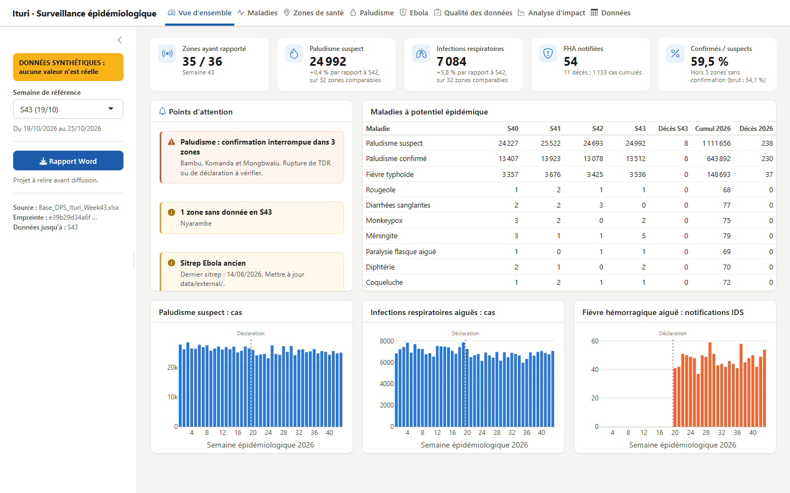
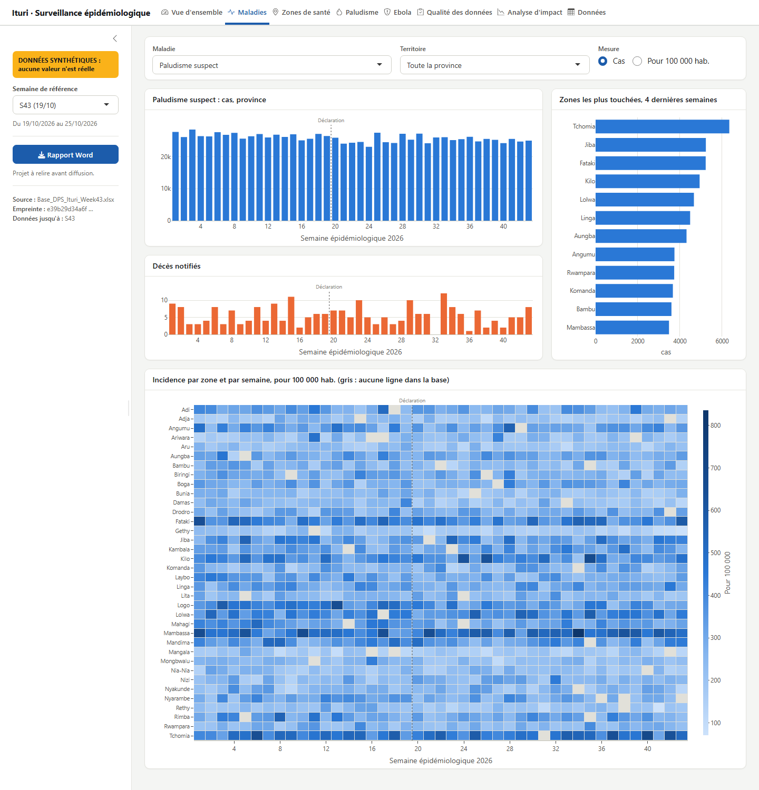
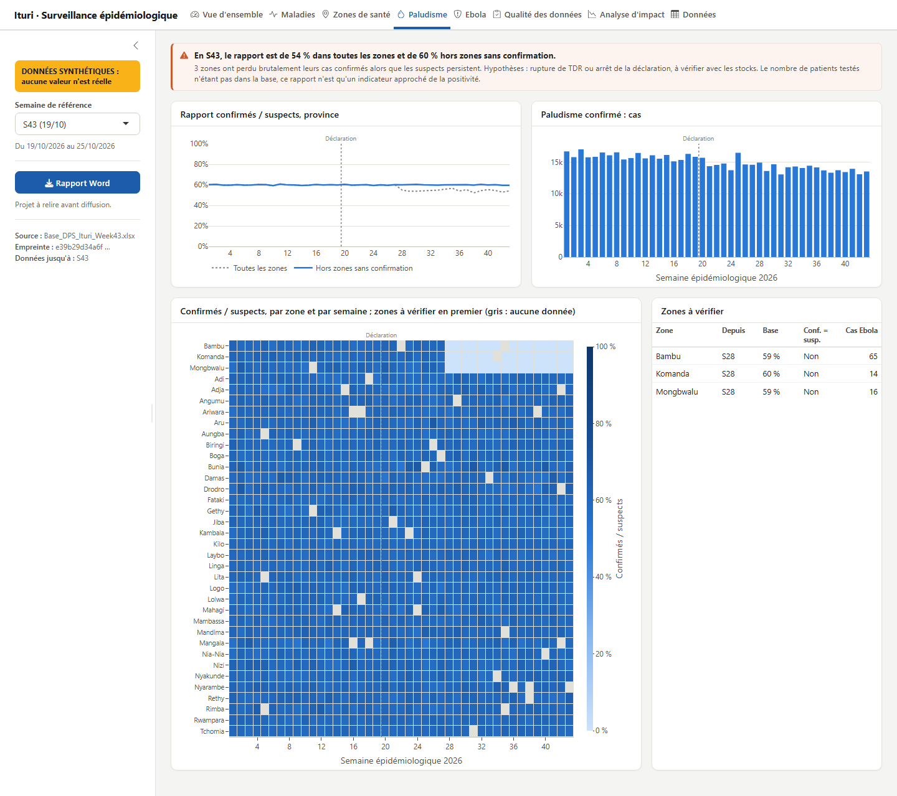
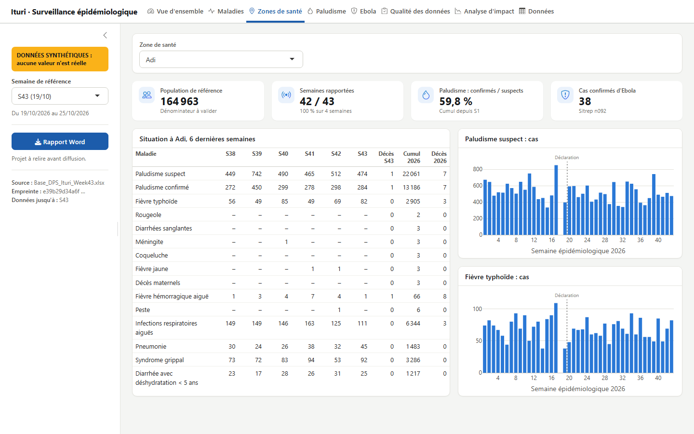
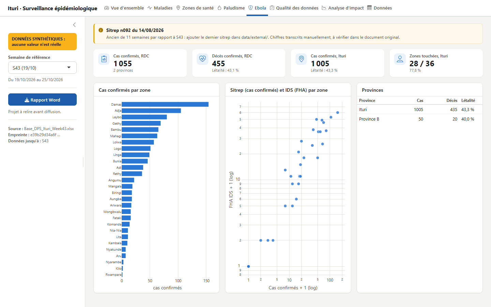
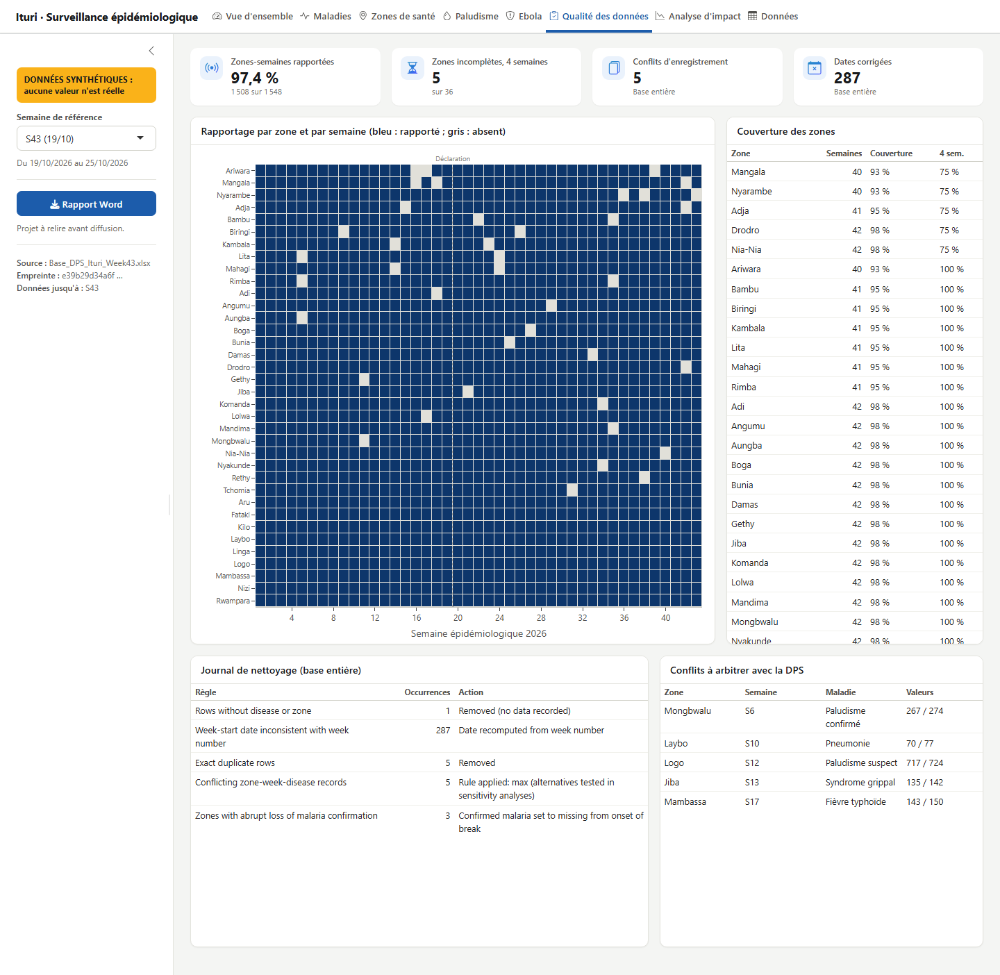
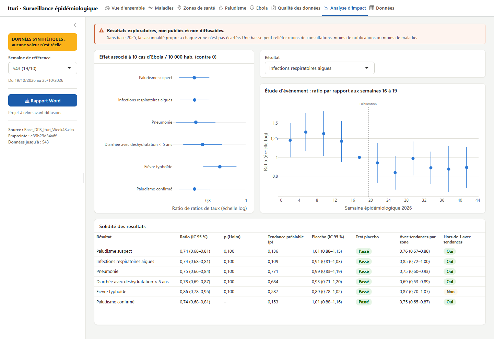
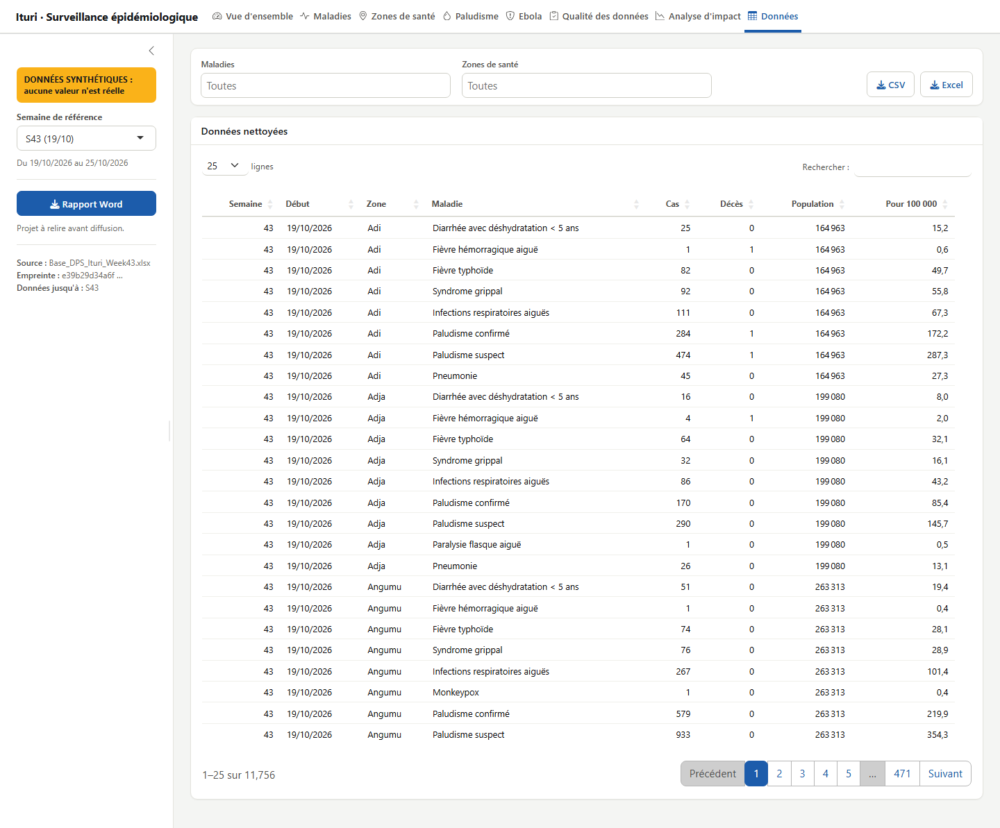
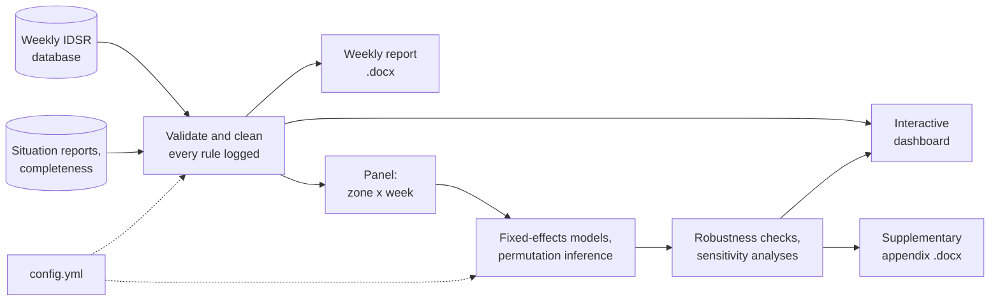

# Ituri epidemiological surveillance: automated reporting and reproducible analysis

[](https://github.com/Abson-dev/ituri-situation-epidemiologique/actions/workflows/verification.yml)


[Version française](README.fr.md)

An R pipeline that turns the weekly Integrated Disease Surveillance and Response (IDSR) database of Ituri province, Democratic Republic of the Congo, into three products:

- **A weekly epidemiological report** in Word, with narrative text computed from the data.
- **An interactive dashboard** for exploring diseases, health zones, malaria confirmation, Ebola and data quality.
- **A controlled interrupted time series analysis** of how notified routine morbidity changed with Ebola burden across 36 health zones.

> **Status:** work in progress. Real data and the manuscript text are withheld until the data owners authorise their release ([data availability](#data-availability)).

## Try it without real data

Demo mode generates a synthetic database that has the same structure and defects as real surveillance data, then runs the tests, the weekly report, the models and the supplementary appendix.

```bash
Rscript -e "install.packages('renv'); renv::restore()"
Rscript run_all.R --demo
```

Outputs appear in `outputs/demo/` and are labelled as synthetic. The same steps run on a clean Ubuntu machine at every push.

**Requirements:** R 4.5.2 and Pandoc (bundled with RStudio).

## Dashboard

On Windows, double-click [`dashboard/Lancer_tableau_de_bord.bat`](dashboard/Lancer_tableau_de_bord.bat). On any system, run `Rscript dashboard/lancer.R`. The dashboard opens in a browser, in French, and is reachable only from the local computer.

| Page | Question it answers |
|---|---|
| Vue d'ensemble | What needs attention this week? |
| Maladies | How is a disease evolving, where, and at what incidence? |
| Zones de santé | What is the situation in a given zone? |
| Paludisme | Does the trend reflect disease or a loss of confirmation? |
| Ebola | What does the latest situation report say, and does it agree with IDSR? |
| Qualité des données | Which zones are missing, and which conflicts need resolving? |
| Analyse d'impact | Which analysis results withstand the robustness checks? |
| Données | Filter and export to CSV or Excel |

Without a real database, the dashboard starts on synthetic data and shows a banner. The impact page needs models computed by `Rscript run_all.R --cible=article`. See the [dashboard guide](dashboard/README.md).

### Screenshots

**All screenshots use synthetic data. No value shown is real, and zone names appear only to illustrate the layout.**



| Diseases | Malaria |
|---|---|
| [](docs/captures/maladies.png) | [](docs/captures/paludisme.png) |

| Health zones | Ebola |
|---|---|
| [](docs/captures/zones-de-sante.png) | [](docs/captures/ebola.png) |

| Data quality | Impact analysis |
|---|---|
| [](docs/captures/qualite-des-donnees.png) | [](docs/captures/analyse-impact.png) |

| Data |
|---|
| [](docs/captures/donnees.png) |

## Pipeline



## Usage

| Task | Command |
|---|---|
| Full run on synthetic data | `Rscript run_all.R --demo` |
| Dashboard | `dashboard/Lancer_tableau_de_bord.bat` |
| Dashboard on synthetic data | `dashboard/Lancer_tableau_de_bord.bat --demo` |
| Weekly report for week 44 | `Rscript run_all.R --cible=hebdo --semaine=44` |
| Analysis and appendix | `Rscript run_all.R --cible=article` |
| Recompute cached models | `Rscript run_all.R --cible=article --forcer` |
| Tests only | `Rscript run_all.R --cible=tests` |

Code identifiers and command options are in French, the working language of the surveillance teams who run the pipeline.

## Methods in brief

| Element | Choice |
|---|---|
| Design | Controlled interrupted time series with a continuous exposure |
| Unit | Health-zone week |
| Estimand | Ratio of rate ratios, after versus before outbreak declaration, by local burden |
| Estimator | Poisson pseudo-likelihood with zone and week fixed effects |
| Inference | Zone-clustered standard errors, *t*(G−1) reference, permutation tests, Holm adjustment |
| Checks | Event study, placebo break, zone-specific trends, alternative exposures, leave-one-zone-out, negative binomial mixed model, randomised quantile residuals |

Full details are in the [analysis plan](docs/analysis_plan.md), and reporting items are mapped in the [STROBE/RECORD checklist](docs/checklist_STROBE_RECORD.md).

## Reproducibility

| Guarantee | How |
|---|---|
| Same software | R and all package versions locked in [`renv.lock`](renv.lock) |
| Same data | Input identified by SHA-256 hash, printed in every output |
| Same random numbers | Seed set in [`config.yml`](config.yml); repeated runs verified identical |
| Traceable cleaning | Raw files never edited; each rule logged with its count; manual corrections kept in a separate audited file |
| No hidden choices | Thresholds and analytic options live in `config.yml` |
| Continuous checks | [GitHub Actions](.github/workflows/verification.yml) runs the demo from a clean checkout |
| Correctness | [Tests](tests/testthat) cover data invariants and recovery of a known simulated effect |

The demo proves that the code runs. Reproducing the real results also requires the authorised data. Continuous checks do not launch the dashboard.

## Repository structure

```text
├── run_all.R                 Single entry point
├── config.yml                All parameters
├── R/                        Cleaning, indicators, models, figures, synthetic data
├── rapports/                 R Markdown sources and bibliography
├── tests/testthat/           Automated tests
├── data/README.md            Data dictionary and required files
├── dashboard/                Interactive Shiny dashboard and Windows launcher
├── notes/                    Local weekly field notes (not versioned)
├── docs/                     Analysis plan, reporting checklist, screenshots
├── renv.lock                 Locked dependencies
└── .github/workflows/        Continuous verification
```

## Data availability

The surveillance data belong to the Provincial Health Division (DPS) of Ituri and are not in this repository, nor are situation-report transcriptions, field notes, generated reports, local settings (`config.local.yml`), or the manuscript text. Requests should be addressed to the data owners. [`data/README.md`](data/README.md) lists the expected files, the data dictionary, and the hash of the analysis dataset.

## Citation and licence

Citation details are in [`CITATION.cff`](CITATION.cff). The code and documentation in this repository are released under the [MIT licence](LICENSE). The licence does not cover the surveillance data, which belong to their owners and are not distributed here. Contribution guidelines are in [`CONTRIBUTING.md`](CONTRIBUTING.md).
